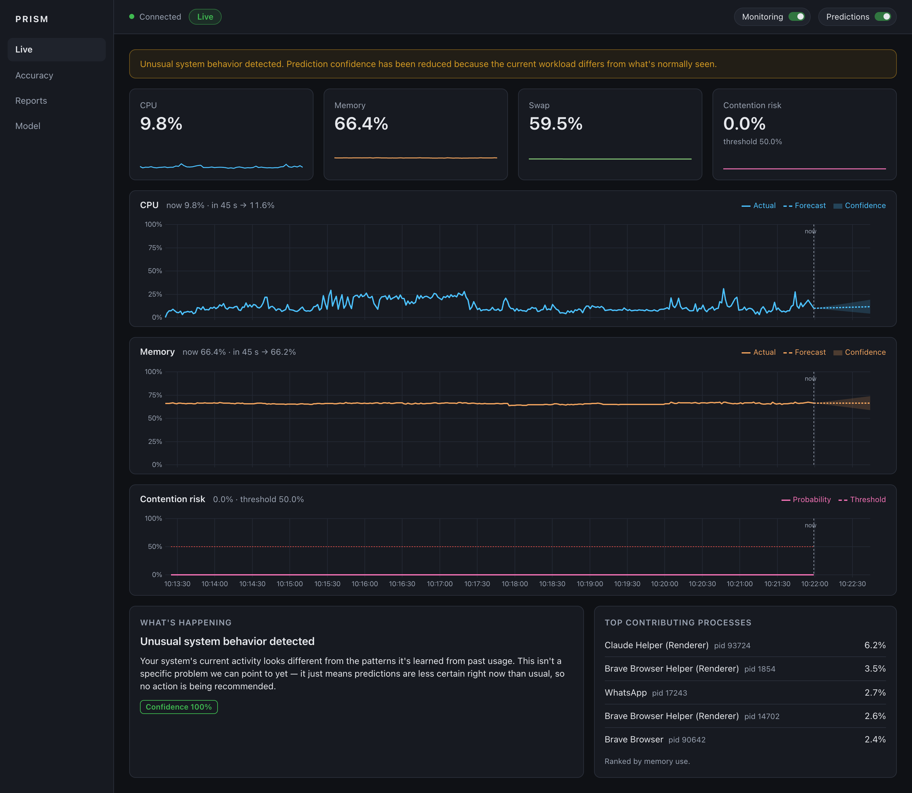

# PRISM — AI System Performance Optimizer

Predictive, explainable system-health monitoring for a personal computer
(macOS). PRISM watches the machine, forecasts where CPU and memory are
heading 45 s and 210 s ahead, estimates the risk of a slowdown, explains
the likely cause and suggests what to do — all on the device, with no data
leaving it.



- **Forecasting:** LightGBM, chosen over Random Forest and Ridge in a
  controlled comparison on real usage, and only served if it beats the
  best of three statistical baselines by 5 %.
- **Risk and explanation:** a logistic-regression contention classifier,
  an Isolation Forest anomaly score, and SHAP to name the cause.
- **Advice:** three curated actions for each of eight cause categories.
- **Dashboard:** a browser UI served by the same FastAPI server — Live,
  Accuracy, Reports, Compare and Model views.

The paper is in [`paper/prism_ieee.pdf`](paper/prism_ieee.pdf) and the
final-review deck in [`paper/PRISM_Final_Review.pdf`](paper/PRISM_Final_Review.pdf).

## Quickstart

Requires **Python 3.12** on macOS.

```bash
python3.12 -m venv .venv
source .venv/bin/activate
pip install -e ".[dev]"
```

```bash
aiperfopt doctor
```

`doctor` prints every resolved path, the active model, and whether the
system can predict right now — and tells you what to run next. From a
standing start:

```bash
aiperfopt run                 # collect, predict and open the dashboard
```

Leave it running to build up real usage history, then train and deploy a
model on it:

```bash
aiperfopt train --deploy
```

The dashboard is at <http://127.0.0.1:8000/>; the API's interactive docs
are at <http://127.0.0.1:8000/docs>. Prediction needs about two minutes of
history after a cold start.

## Commands

| Command | What it does |
|---|---|
| `aiperfopt doctor` | Environment, paths, active model and readiness |
| `aiperfopt run` | Start the server and open the dashboard in a browser |
| `aiperfopt serve [--no-monitor]` | Start the server only; `--no-monitor` skips collection (for replay) |
| `aiperfopt collect [--minutes N \| --forever]` | Collect metrics without the server |
| `aiperfopt train [--version V] [--deploy]` | Train a candidate on accumulated real usage; `--deploy` activates it |
| `aiperfopt compare [--raw]` | Compare LightGBM, Random Forest and Ridge; writes `results/model_comparison*` |
| `aiperfopt evaluate [--ablation] [--report]` | System-only vs. system+process ablation; `--report` writes the `results/` evidence pack |
| `aiperfopt record --minutes N --out F` | Save a window of collected history as a session file |
| `aiperfopt replay --session F [--speed N]` | Replay a session into a separate database for demos |
| `aiperfopt export-training-window --since T --out F` | Export metrics and process summaries as JSON |

Every command also works as `python -m aiperfopt <command>`. A
step-by-step demonstration is in [`docs/demo-script.md`](docs/demo-script.md).

## Where your data lives

Everything PRISM writes — the SQLite database, trained models, logs and
the active-version pointer — lives under one application home, by default
`~/Library/Application Support/aiperfopt`. Override it with
`AIPERFOPT_HOME`. `aiperfopt doctor` always prints exactly which files are
in use.

Model-comparison results are written to `results/` in the working
directory; the dashboard's Compare view reads them from there, so start
the server from the project folder.

## Configuration

Layered, highest priority first:

1. Environment variables — prefix `AIPERFOPT_`, nested delimiter `__`
   (e.g. `AIPERFOPT_MONITORING__POLLING_INTERVAL_SECONDS=2.0`)
2. A `.env` file
3. A user override YAML — `--config`, or `AIPERFOPT_CONFIG_FILE`
4. The packaged defaults (`src/aiperfopt/resources/default.yaml`)

Relative paths in any layer resolve against `AIPERFOPT_HOME`, never the
working directory.

## Tests

```bash
python -m pytest -q                         # 500 Python tests
node --test src/aiperfopt/web/static/js/    # 24 dashboard JS tests
```

Every Python test is marked `behavioural` (asserts a computed value is
correct) or `plumbing` (asserts only that code ran); `--strict-markers`
rejects anything unmarked. Per-module counts are generated, not
hand-maintained:

```bash
python scripts/generate_module_table.py     # writes docs/module-table.md
```

CI (`.github/workflows/ci.yml`) runs both suites on `macos-latest` and
checks that a built wheel contains its configuration.

## Project layout

```
src/aiperfopt/
├── monitoring/    psutil collectors, ingestion queue, batched writer
├── storage/       SQLite schema, reader, writer, roll-up and retention
├── features/      feature engine (254 features) and preprocessing
├── forecasting/   LightGBM forecaster, baselines, walk-forward evaluation
├── anomaly/       Isolation Forest detector
├── contention/    contention classifier and its training pipeline
├── insight/       diagnosis (SHAP, cause taxonomy) and recommendations
├── lifecycle/     deployment gate, retraining, confirm and rollback
├── evaluation/    three-model comparison, ablation, evidence pack
├── reporting/     daily/weekly summaries, predicted vs. actual
├── replay/        record and replay sessions
├── api/           FastAPI app, routers, live-inference loop
├── web/static/    the dashboard (plain JS + uPlot, no build step)
├── config/, applog/, common/, resources/
└── cli.py         the aiperfopt command
scripts/           paper analysis and figures, module-table generator
paper/             IEEE paper source and PDF, final-review deck
docs/              architecture, module table, demo script, plans, archive
```

See [`docs/architecture.md`](docs/architecture.md) for the pipeline
diagram and [`docs/module-table.md`](docs/module-table.md) for test counts
per module.

## Reproducing the paper's numbers

The paper's analyses run on a frozen copy of the database:

```bash
AIPERFOPT_HOME=paper_snapshot aiperfopt compare
AIPERFOPT_HOME=paper_snapshot python scripts/paper_analysis.py
python scripts/paper_figures.py
```

The model-comparison CSVs in `results/` are committed, so the Compare
view works on a fresh clone; the database snapshot and other generated
outputs are not (see `.gitignore`).
