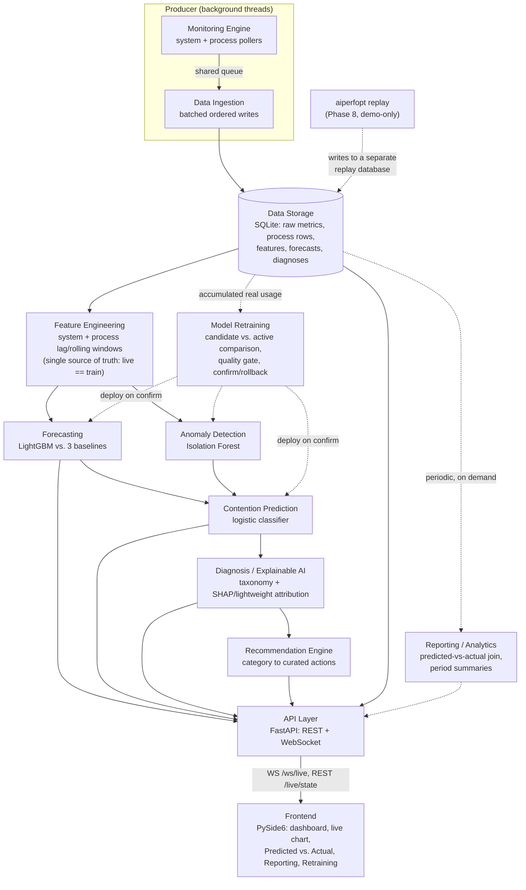

# Architecture (Phase 10.1)

Source-of-truth diagram for Review 2's System Design and Architecture
requirement. Rendered from Mermaid so it stays a diffable text file, not a
one-off exported image (`docs/plans/2026-09-12-presentable-predictive-monitor.md`,
Phase 10 Deliverable 1).

## Pipeline

Every stage below is a real module under `src/aiperfopt/` (see
[`docs/phase10-module-table.md`](phase10-module-table.md) for
responsibilities, source paths, and test counts). Solid arrows are the
per-cycle live-inference path (`aiperfopt.api.live_state.LiveInferenceLoop._tick`,
one cycle every `api.live_inference_interval_seconds`); dashed arrows are
the two loops that run on their own separate cadence rather than every
tick.

## Notes that don't fit in the picture

- **Replay is not a twelfth module.** It reuses the same Storage/Feature/Forecasting/Contention path against a separate replay database (`<primary>-replay.<ext>`), pacing writes from a previously recorded session rather than a live poller. The API server is told it's serving replayed data via `StorageSettings.is_replay` (`AIPERFOPT_STORAGE__IS_REPLAY=true`), which the Frontend surfaces as the `REPLAY` readiness state.
- **`/readiness` is deliberately outside the live-inference loop.** It answers "can this system predict right now, and why not" from `aiperfopt.readiness.assess_readiness`, callable with no server running at all (`aiperfopt doctor`) — it is not one of the boxes above because it inspects Storage and the active model pointer directly rather than participating in the per-cycle tick.
- **Retraining never auto-deploys.** `run_retraining_on_real_usage_data` produces a candidate and a comparison against the currently active version; `confirm_deployment` requires an explicit `confirmed=True` from an operator (CLI, API, or the Retraining tab) before Forecasting/Contention/Anomaly's active artifacts change.
