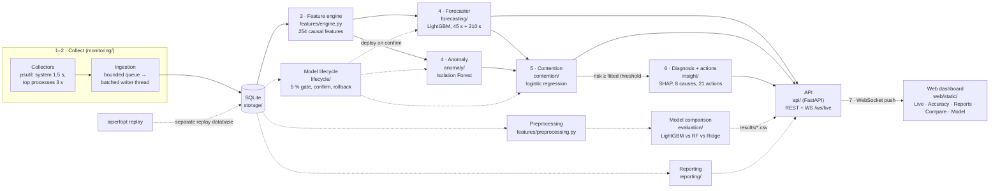

# Architecture

How one sample travels from the operating system to the dashboard. Every
box is a real package under `src/aiperfopt/`; see
[`module-table.md`](module-table.md) for responsibilities and test counts.

Solid arrows are the live path. The live-inference loop
(`api/live_state.py`, `LiveInferenceLoop._tick`) runs steps 3–6 once every
`api.live_inference_interval_seconds` (5 s) on its own thread. Dashed
arrows run on their own cadence: training, comparison and reporting.

## Notes

- **Training and live features are the same code.** `features/engine.py`
  builds the feature matrix for both; a test asserts a live vector equals
  the training vector for the same timestamp.
- **Preprocessing runs at training and comparison time only.** Its column
  decisions are fitted on training rows and refitted in every
  cross-validation fold.
- **Nothing deploys automatically.** The lifecycle produces a candidate and
  a comparison against the active version; an operator confirms in the CLI,
  the API or the dashboard's Model view, and any deployment can be rolled
  back. A forecaster that does not beat the best baseline (persistence,
  moving average, Holt) by 5 % is never served.
- **The Compare view reads saved results.** `GET /comparison/models` serves
  `results/model_comparison*.csv` written by `aiperfopt compare`; the API
  never runs the comparison itself.
- **Replay never touches the primary database.** `aiperfopt replay` writes a
  recorded session into `<primary>-replay.<ext>`; a server pointed at it
  with `AIPERFOPT_STORAGE__IS_REPLAY=true` shows a REPLAY badge.
- **`/readiness` sits outside the loop.** `readiness.assess_readiness`
  answers "can this system predict right now, and why not" from storage and
  the active-model pointer, with or without a server (`aiperfopt doctor`).
